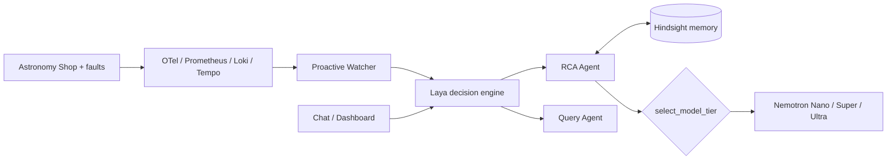

# Incident Response Agent: an SRE copilot that remembers

> Built for the **Nebius x NVIDIA Global AI Hackathon** · Track: **Best apps and agents**

An AI on-call teammate. It watches a microservice stack, opens incidents on its own, finds the root cause, and **remembers which fixes worked or failed**, so a repeat of a known problem is checked against memory first and handled by a smaller, cheaper model.

- **Live demo:** https://34-30-44-247.sslip.io/ (chat) · [dashboard](https://34-30-44-247.sslip.io/dashboard) · [faults deck](https://34-30-44-247.sslip.io:8443/faults) (needs the demo key below)
- **Video (<3 min):** https://youtu.be/s0BdthyU7To
- **What changed in the Submission Period:** [docs/WHAT_CHANGED.md](docs/WHAT_CHANGED.md)
- **License:** see [LICENSE](LICENSE)

## Why it matters
Teams cutting observability and on-call cost still need fast RCA. Most AI SRE tools start from zero every incident. This one keeps episodic memory (Hindsight), so a repeat incident is verified with one short model call instead of a multi-call investigation (in our benchmark run: 1 call and about 480 tokens against 4 calls and about 25,600 tokens for a new incident; single run, see [Benchmark](#benchmark)).

## How it works

1. **Watcher** detects an SLO breach and opens an incident.
2. **Laya** decides if a chat message is the same incident or a new one, and whether it is an RCA or a query.
3. **RCA agent** recalls past fixes from Hindsight, then picks a Nemotron tier.
4. You mark **Fix Worked / Fix Failed**; the outcome is stored for next time.

## NVIDIA Nemotron usage
| Situation | Tier | Token Factory model (env var) | Size |
|---|---|---|---|
| New incident | Ultra | `nvidia/Nemotron-3-Ultra-550b-a55b` (`NEBIUS_ULTRA_MODEL`) | 550B, 55B active |
| Context shift | Super | `nvidia/nemotron-3-super-120b-a12b` (`NEBIUS_SUPER_MODEL`) | 120B, 12B active |
| Repeat of a known fix | Nano | `nvidia/NVIDIA-Nemotron-3-Nano-30B-A3B` (`NEBIUS_NANO_MODEL`) | 30B, 3B active |

All three are NVIDIA open Nemotron models, and Super and Ultra are different models. These ids are the defaults in `.env.example`; the full list the key can use is in [docs/token_factory_models.txt](docs/token_factory_models.txt). The NVIDIA NIM fallback uses its own ids (`NEMOTRON_*_MODEL` in `Copilot/agent/config.py`), where Super and Ultra default to the same model. Tier choice is visible per incident as a `diagnosis:tier` timeline event, and per chat answer as a badge (tier, model, provider).

## Where Nebius Token Factory fits
Token Factory is the primary inference provider (`INFERENCE_PROVIDER=nebius`, OpenAI-compatible, `https://api.tokenfactory.nebius.com/v1`). It serves all three tiers and optionally the Hindsight memory LLM. The hosted demo runs on a Google Cloud VM (e2-standard-4, Docker Compose + Caddy TLS, see [docs/DEPLOY.md](docs/DEPLOY.md)); its runtime inference calls go to the Token Factory API. We do not use Nebius AI Cloud compute.

**Honest status:** the hosted demo and the benchmark below run on Nebius Token Factory (`INFERENCE_PROVIDER=nebius`). The demo video was recorded earlier on NVIDIA NIM, before the Token Factory run, so its model ids differ from the table above. NIM and Groq remain optional fallbacks.

## Benchmark
Measured with `python scripts/benchmark_tiers.py` on Token Factory (single replicate, so treat it as indicative, not statistical). Full table and method: [docs/benchmark.md](docs/benchmark.md), raw data: [docs/benchmark.json](docs/benchmark.json).

| Scenario | Tier chosen | Model | Watcher auto-diagnosis | Model calls | Tokens |
|---|---|---|---|---|---|
| New incident | Ultra | `Nemotron-3-Ultra-550b-a55b` | 14.3 s (full RCA) | 4 | about 25,600 |
| Context shift | Super | `nemotron-3-super-120b-a12b` | 7.9 s (full RCA) | 2 | about 16,200 |
| Repeat after Fix Worked | Nano | `NVIDIA-Nemotron-3-Nano-30B-A3B` | 3.0 s (memory-first check) | 1 | about 480 |

What this supports: tier routing picks the expected tier in all three scenarios, and a repeat of a remembered fix is verified with far fewer model calls and tokens. What it does not show: in this run the repeat scenario's operator chat answer returned an error after 120 s, so we make no end-to-end chat-latency claim for repeats; that case is being re-measured.

## Quick start
Prereqs: Docker + Docker Compose, a Nebius Token Factory key.
```bash
git clone https://github.com/satwikt/incident_response_agent.git
cd incident_response_agent
cp .env.example .env        # set NEBIUS_API_KEY; MEMORY_MODE=on
python scripts/list_models.py   # copy model IDs into NEBIUS_*_MODEL
docker compose up -d --build
./scripts/index_docs.sh         # build docs RAG index
```
NVIDIA NIM and Groq keys are optional fallbacks. To host it on a VM, follow [docs/DEPLOY.md](docs/DEPLOY.md).

| URL | What |
|---|---|
| http://localhost:9922 | Shop + fault deck (`/faults`) |
| http://localhost:9911 | Copilot chat + dashboard (`/dashboard`) |
| http://localhost:3001 | Grafana |

Stack: frontend, catalog, checkout, Postgres, Prometheus, Tempo, Loki, Grafana, copilot, hindsight, adapter.

## Test it as a judge (about 5 minutes)
Hosted demo, nothing to install. Full local checklist: [docs/DEMO_TEST_FLOW.md](docs/DEMO_TEST_FLOW.md).

- Chat: https://34-30-44-247.sslip.io/ · Dashboard: https://34-30-44-247.sslip.io/dashboard
- Shop and faults deck: https://34-30-44-247.sslip.io:8443/ and https://34-30-44-247.sslip.io:8443/faults
- Demo key (asked when you change a fault :`0d4a15059f680ff251b8e25c6caec84a7fdc0ed65e9687a8`

1. Open the faults deck, enter the demo key, enable **Payment Failure**.
2. In the shop, place a few orders (or use "Trigger Test Order" / "Burst 10 Requests" on the deck) so errors are generated.
3. Open the dashboard: within about a minute the watcher opens an incident. In the chat ask "why is checkout failing?" -> **Ultra** tier.
4. Disable the fault, wait about 90 s, then click **Fix Worked** on the incident (dossier).
5. Enable the same fault again and ask again -> **Nano** tier, using the remembered fix. The `diagnosis:tier` line in the incident dossier shows the tier and model.

The demo has hourly and daily LLM limits; when they are reached it shows a clearly labelled replay instead. Running locally: `scripts/reset_demo.ps1` (or `scripts/reset_demo.sh`) resets the state.

## Known limits
- Only the checkout service is watched.
- Free-tier Groq as the memory LLM can lag; use Token Factory for Hindsight.
- Hosted demo is rate-limited and falls back to a labelled replay when the budget is spent.

## Third-party components
OpenTelemetry, Prometheus, ChromaDB, Google ADK, LiteLLM and Caddy are used under their open-source licenses (Apache-2.0 or MIT). Grafana, Loki and Tempo (AGPL-3.0) run as separate, unmodified services. Hindsight is used under its own license. Models: NVIDIA Nemotron open models served by Nebius Token Factory. This project is licensed under Apache-2.0 ([LICENSE](LICENSE)).

## Tests
```bash
pip install -e ".[dev]" && pytest
```

## Team
Satwik Thakkar (architecture, memory layer, **Representative**) · Sahil Deo (ADK agents).
