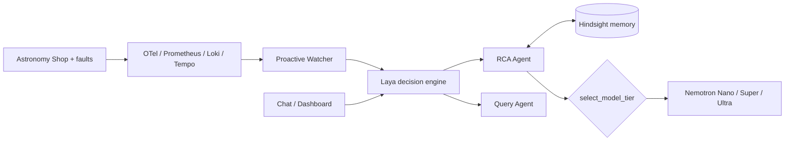

# Incident Response Copilot: an SRE agent that remembers

> Built for the **Nebius x NVIDIA Global AI Hackathon** · Track: **<TRACK>**

An AI on-call teammate. It watches a microservice stack, opens incidents on its own, finds the root cause, and **remembers which fixes worked or failed**, so the next occurrence is diagnosed faster and with a smaller, cheaper model.

- **Live demo:** <DEMO_URL>
- **Video (<3 min):** <YOUTUBE_URL>
- **What changed in the Submission Period:** [docs/WHAT_CHANGED.md](docs/WHAT_CHANGED.md)
- **License:** see [LICENSE](LICENSE)

## Why it matters
Teams cutting observability and on-call cost still need fast RCA. Most AI SRE tools start from zero every incident. This one keeps episodic memory (Hindsight), so repeat incidents cost one small-model call instead of a full investigation.

## How it works

1. **Watcher** detects an SLO breach and opens an incident.
2. **Laya** decides if a chat message is the same incident or a new one, and whether it is an RCA or a query.
3. **RCA agent** recalls past fixes from Hindsight, then picks a Nemotron tier.
4. You mark **Fix Worked / Fix Failed**; the outcome is stored for next time.

## NVIDIA Nemotron usage
| Situation | Tier | Model (env var) |
|---|---|---|
| New incident | Ultra | `NEBIUS_ULTRA_MODEL` |
| Context shift | Super | `NEBIUS_SUPER_MODEL` |
| Repeat of a known fix | Nano | `NEBIUS_NANO_MODEL` |

Defaults are in `Copilot/agent/config.py`. **Disclosure:** by default Super and Ultra point to the same model (`nvidia/nemotron-3.5-super-vl-120b-a12b`); Nano is `nvidia/nemotron-3.5-lightning-30b-a3b`. Tier choice is visible per incident as a `diagnosis:tier` timeline event.

## Where Nebius Token Factory fits
Token Factory is the primary inference provider (`INFERENCE_PROVIDER=nebius`, OpenAI-compatible, `https://api.tokenfactory.nebius.com/v1`). It serves all three tiers and optionally the Hindsight memory LLM. The hosted demo runs on a Nebius AI Cloud VM ([docs/DEPLOY.md](docs/DEPLOY.md)).

**Honest status:** <FILL: which provider the demo video and hosted demo actually ran on. The video was recorded on NVIDIA NIM; Token Factory support is implemented and exercised by <FILL>.>

## Benchmark
<FILL after running `python scripts/benchmark_tiers.py --runs 3`; results land in `docs/benchmark.md`.>

## Quick start
Prereqs: Docker + Docker Compose, a Nebius Token Factory key.
```bash
git clone https://github.com/satwikt/incident_response_agent.git
cd incident_response_agent
cp .env.example .env        # set NEBIUS_API_KEY; MEMORY_MODE=on
python scripts/list_models.py   # copy model IDs into NEBIUS_*_MODEL
docker compose up -d --build
./scripts/index_docs.sh         # build docs RAG index
```
NVIDIA NIM and Groq keys are optional fallbacks.

| URL | What |
|---|---|
| http://localhost:9922 | Shop + fault deck (`/faults`) |
| http://localhost:9911 | Copilot chat + dashboard (`/dashboard`) |
| http://localhost:3001 | Grafana |

Stack: frontend, catalog, checkout, Postgres, Prometheus, Tempo, Loki, Grafana, copilot, hindsight, adapter.

## Test it as a judge (about 5 minutes)
Full checklist: [docs/DEMO_TEST_FLOW.md](docs/DEMO_TEST_FLOW.md). Fault endpoints need the demo key `CHAOS_KEY=<DEMO_KEY>`.
1. Reset: `scripts\reset_demo.ps1` (or `scripts/reset_demo.sh`).
2. Open `/faults`, enable **payment_failure**, generate a few checkouts.
3. Wait for the watcher to open an incident on the dashboard; ask the chat "why is checkout failing?" -> **Ultra** tier.
4. Disable the fault, wait ~90 s, click **Fix Worked**.
5. Re-enable the fault; ask again -> **Nano** tier, using the remembered fix.

## Known limits
- Only the checkout service is watched.
- Free-tier Groq as the memory LLM can lag; use Token Factory for Hindsight.
- Hosted demo is rate-limited and falls back to a labelled replay when the budget is spent.

## Tests
```bash
pip install -e ".[dev]" && pytest
```

## Team
Satwik Thakkar (architecture, memory layer, **Representative**) · Sahil Deo (ADK agents).
