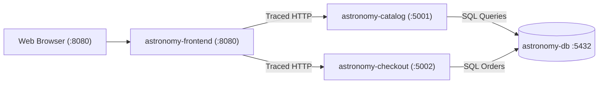

# System Architecture

## 1. Overview

The **AI Incident Response Agent** is an autonomous and interactive Site Reliability Engineering copilot that monitors cloud-native distributed microservices, diagnoses incidents using episodic and procedural memory, and guides operators through remediation.

The application under test is the **Astronomy Shop Lite** microservices mesh—a focused 3-service architecture backed by PostgreSQL and fully observed via the **LGTM** stack (Prometheus, Loki, Tempo, Grafana).

---

## 2. Multi-Agent Architecture

The copilot decomposes incident response into three specialized agents:

### 2.1 Proactive Alerting Agent (Detection & Alerting)
- **Engine:** [`Copilot/agent/watcher.py`](file:///Users/sahil/Developer/Hackathons/Nvidea-Global/incident_response_agent/Copilot/agent/watcher.py) & [`Copilot/agent/cycle.py`](file:///Users/sahil/Developer/Hackathons/Nvidea-Global/incident_response_agent/Copilot/agent/cycle.py).
- **Role:** Continuous background loop sampling metrics (`error_rate`, `latency`, `slow_requests`, `health`).
- **Behavior:**
  - Evaluates threshold breaches and deduplicates them into persistent incidents in SQLite.
  - Dispatches immediate Discord webhook alerts with incident evidence summaries without blocking detection.
  - Enqueues incident diagnosis jobs into the asynchronous `DiagnosisService`.

### 2.2 Reactive RCA Agent (Diagnostic Reasoning)
- **Engine:** [`Copilot/agent/rca_agent.py`](file:///Users/sahil/Developer/Hackathons/Nvidea-Global/incident_response_agent/Copilot/agent/rca_agent.py).
- **Role:** Root cause analysis and verified fix recommendation.
- **Workflow:**
  1. Queries **Hindsight Memory** for historical incidents with similar symptoms.
  2. Routes context through the **Laya Decision Engine**:
     - **Completely new incident (no past matches):** Dispatches **NVIDIA Nemotron Ultra** (`nvidia/nemotron-3.5-super-vl-120b-a12b`) for deep reasoning from scratch.
     - **Past incident recalled with context shift (new release / config drift):** Dispatches **NVIDIA Nemotron Super** (`nvidia/nemotron-3.5-super-vl-120b-a12b`) for guided comparative diagnosis.
     - **Past incident recalled with identical context:** Dispatches **NVIDIA Nemotron Nano** (`nvidia/nemotron-3.5-lightning-30b-a3b`) for fast solution adaptation.
  3. Proposes an operational fix strictly from `ALLOWED_ACTIONS`.
  4. Prompts the operator for verification feedback (`POST /api/incidents/{id}/feedback`).

### 2.3 Reactive Query Agent (Telemetry & Documentation Lookups)
- **Engine:** [`Copilot/agent/query_agent.py`](file:///Users/sahil/Developer/Hackathons/Nvidea-Global/incident_response_agent/Copilot/agent/query_agent.py).
- **Role:** Handles ad-hoc user inquiries from the chat interface.
- **Guarantees:**
  - Strictly read-only; never mutates incident states or proposes destructive actions.
  - Equipped with injection-proof Prometheus, Loki, Tempo, and RAG document search tools.
  - Formats responses into structured paragraphs of real data with zero internal thought leakage.

---

## 3. Astronomy Shop Lite (3 Services + DB)

Instead of compiling 16 polyglot microservices from scratch, Astronomy Shop Lite delivers the complete store experience and distributed telemetry using a clean 3-service Python mesh:

1. **Frontend Gateway Service (`services/frontend/`, Port 8080)**:
   - Serves the store UI (`/`) and the interactive Faults Dashboard (`/faults`).
   - Injects W3C `traceparent` headers across downstream catalog and checkout calls.
   - Includes a background synthetic traffic loop simulating regular customer browsing and cart activity.
2. **Catalog & Cart Service (`services/catalog/`, Port 5001)**:
   - Manages product inventory and shopping cart states.
   - Emits custom spans for catalog lookups, cart additions, and stock checks.
3. **Checkout & Order Service (`services/checkout/`, Port 5002)**:
   - Orchestrates order payment, validation, and database persistence.
   - Hosts the **Fault Injection Engine** simulating payment gateway drops, latency delays, and DB pool exhaustion.
4. **Database (`astronomy-db`, PostgreSQL 16)**:
   - Stores catalog, customer carts, and completed orders.

---

## 4. Runtime Faults Dashboard (`/faults`)

Located at `http://localhost:8080/faults`, this interface enables operators to inject live anomalies and immediately view AI Copilot detection:

- **Payment Failure**: Forces HTTP 500 on checkout to simulate payment gateway timeout.
- **High Latency Spike**: Injects 2.5s–3.5s delays into requests to simulate network throttling.
- **DB Pool Exhaustion**: Holds database connections to simulate connection leak and trigger 503 errors.
- **Product Image Delay**: Adds 3s delays to image asset loading.
- **Memory Leak**: Allocates 20MB memory buffers per request.
- **Error Spike (503)**: Triggers an 80% failure rate across catalog routes.

---

## 5. Laya System 1 Decision Engine

[`Copilot/agent/laya_classifier.py`](file:///Users/sahil/Developer/Hackathons/Nvidea-Global/incident_response_agent/Copilot/agent/laya_classifier.py) provides sub-millisecond heuristic classification:

1. **Incident Context Classification:**
   - Compares runtime facts (release versions, config revisions, exception signatures).
   - Returns `"same_context"` (Nemotron Nano) or `"different_context"` (Nemotron Super).

2. **Chat Intent Classification:**
   - Evaluates incoming operator messages.
   - Dispatches to **Reactive Query Agent** (intent: `"query"`) or **Reactive RCA Agent** (intent: `"rca"`).
