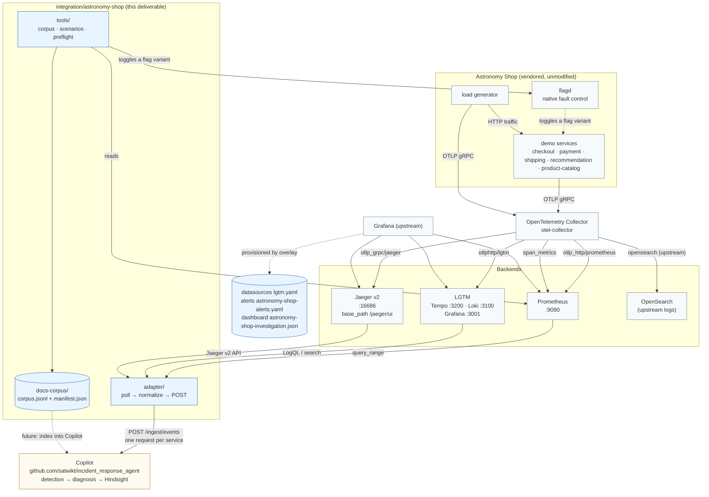
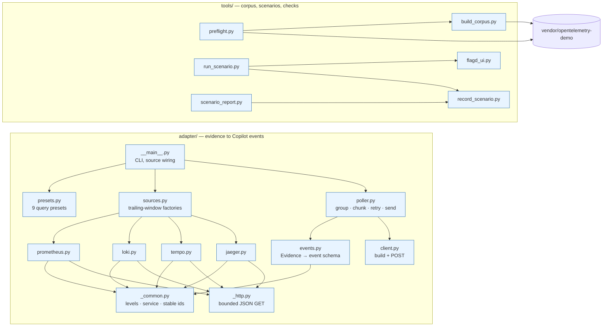
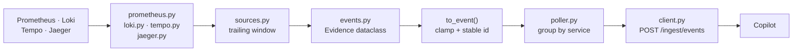

# Code Structure

How the project is laid out and how the pieces fit together. Read this first if you have never seen the codebase; it is a map, not a spec. The rules that must not be broken are in [IMPLEMENTATION-NOTES.md](IMPLEMENTATION-NOTES.md); the requirement-to-check mapping is in [VERIFICATION-MATRIX.md](VERIFICATION-MATRIX.md).

---

## 1. System architecture

The system is two halves: an **unchanged** OpenTelemetry Astronomy Shop demo that produces telemetry, and a **Copilot-facing module** that turns selected telemetry into Copilot ingest events.



### The one-line version

> The demo produces telemetry → the Collector fans it out to Prometheus, Jaeger, and LGTM (Tempo + Loki) → the adapter reads the backends read-only, normalizes what it reads into the Copilot's ingest schema, and POSTs it to the Copilot.

### Layer boundaries (do not cross these)

| Layer | May read | May write | Notes |
|---|---|---|---|
| Demo + vendor | — | — | Never modified. Pinned at `85c2cb253ae3`. |
| Compose overlay / collector extras | — | vendor config files only | Adds LGTM; replaces upstream extras by mount. |
| Grafana provisioning | — | Grafana's own config | Datasource UIDs, alert rules, one dashboard. |
| Adapter | backends (read-only) | the Copilot ingest endpoint | The only thing that talks to the Copilot. |
| Tools | vendor files (read), flagd-ui (read/write) | `scenarios/runs/*.json`, `docs-corpus/` | Never writes vendor files. |

The adapter is **read-only against the backends** and **write-only toward the Copilot**. That is the whole point: the Copilot must reason from externally observable evidence, not from the application's source.

---

## 2. Code structure



Arrows are imports, not calls: each module imports what it needs from the layer below it. There are no circular imports.

---

## 3. Directory tree

```text
/home/vinit/SRE Copilot/
├── docs/                              # design + delivery record (the docs you will edit)
│   ├── CODE-STRUCTURE.md              # this file
│   ├── TEAM-GUIDE.md                  # how to work in this repo day to day
│   ├── TEAM-HANDOFF.md                # full handoff for the integration/completion owner
│   ├── IMPLEMENTATION-NOTES.md        # invariants — read before changing code
│   ├── VERIFICATION-MATRIX.md         # requirement → artifact → check → status
│   ├── FILE-INVENTORY.md              # file-by-file purpose and state
│   ├── status.md                      # what is done, what is not
│   ├── change-log.md                  # dated record of every material change
│   ├── live-validation.md             # first live-run checklist
│   └── ...                            # requirements, architecture, decisions, runbook
│
├── integration/astronomy-shop/        # the deliverable — everything below is ours
│   ├── adapter/                       # evidence → Copilot ingest events
│   ├── tools/                         # corpus, scenario runner, preflight
│   ├── tests/                         # 139 stdlib unittest tests
│   ├── scenarios/                     # catalog.json + recorded runs
│   ├── grafana/                       # datasource, alerts, dashboard
│   ├── docs-corpus/                   # generated corpus.jsonl + manifest.json
│   ├── compose.overlay.yaml           # LGTM + Grafana + collector overlay
│   ├── otelcol-config-extras.yml      # collector merge layer
│   ├── Makefile                       # check · test · preflight · report
│   └── README.md
│
└── vendor/opentelemetry-demo/         # upstream, UNMODIFIED, pinned 85c2cb253ae3
    ├── compose.yaml / compose.full.yaml / compose.observability.yaml / compose.extras.yaml
    ├── src/otel-collector/otelcol-config-extras.yml
    ├── src/flagd/demo.flagd.json
    └── src/<service>/...              # the demo services
```

`vendor/` is a vendored snapshot of upstream `85c2cb2`, committed into this repository rather than cloned at check-out time. `vendor/opentelemetry-demo/.pinned-commit` records the pinned revision, and `make check` fails if that record drifts from the pin or if the working tree differs from the committed copy.

---

## 4. The adapter, file by file

The adapter is a straight pipeline. Each file owns exactly one step.



### `adapter/_http.py` (26 lines)
`get_json(url, timeout)` — the only outbound HTTP helper for backends. Bounded timeout, JSON decode, raises on non-2xx. Every backend client goes through it, so there is one place to change if the auth story changes.

### `adapter/_common.py` (62 lines)
Shared vocabulary for turning backend payloads into evidence:
- `normalize_level(value, default)` — maps a backend's level string to `DEBUG/INFO/WARNING/ERROR/CRITICAL`, with `WARN/ERR/FATAL/TRACE` aliases.
- `pick_service(labels, override)` — resolves the service for an evidence item. **The override always wins**; the labels are only a fallback. This is deliberate: aggregate PromQL drops labels, so a missing `service_name` must never be guessed.
- `stable_id(prefix, *parts)` — deterministic id from content. This is what makes re-polls dedupe.
- `as_int(value)` — tolerant int coercion.
- `pick_attr(labels, *keys)` — reads the first present key. Used because the demo emits `http_response_status_code` on Prometheus metrics but `http.response.status_code` on spans.

### `adapter/events.py` (163 lines)
The ingest contract, in one place.
- `Evidence` — a dataclass: the internal, backend-neutral shape. Fields: `service`, `level`, `message`, `route`, `status`, `duration_ms`, `exception`, `trace_id`, `span_id`, `source`, `timestamp`, `id`.
- `to_event(evidence)` — the only function that produces a Copilot event. It clamps every field to the ingest schema's limits and derives a stable id if none was given.
- `from_mapping(data, source=...)` — the inverse, for building evidence from a raw mapping.
- Clamps: `status` → 100–599, `duration_ms` → 0–3 600 000 and finite, `route` → 200 chars, `exception` → 8192 chars.

> **Why the clamping matters:** the Copilot validates a batch *atomically*. One bad event rejects every other event in the same request with `422`. Clamping is not tidiness — it is what keeps one stray label from taking a whole batch down.

### `adapter/prometheus.py` (97) · `loki.py` (100) · `tempo.py` (96) · `jaeger.py` (135)
One file per backend. Each has the same shape:

| Part | Purpose |
|---|---|
| `SOURCE` | Constant tag written into every event's message. |
| a small dataclass | `Sample` / `LogEntry` / `TraceSummary` / `JaegerTrace` — the parsed shape. |
| a client class | `query` / `query_range` / `search` / `find_traces` — one HTTP call each, via `_http.get_json`. |
| `_parse(payload)` | Backend JSON → dataclass. |
| `to_evidence(item, service=None)` | Dataclass → `Evidence`. **The service override is applied here.** |

Backend-specific things worth knowing:

- **Prometheus** — `query` and `query_range`; `to_evidence` reads `http_response_status_code` for status and `http_route` for route, matching what the demo actually emits. A non-HTTP status label (e.g. `status_code="STATUS_CODE_ERROR"`) is deliberately *not* read as an HTTP status.
- **Loki** — `query_range` with a trailing window; `_line_level` sniffs the level out of the log text when there is no level label; the message is capped at `MESSAGE_LIMIT = 2000`.
- **Tempo** — `search` by service plus `get_trace` for the full trace; a summary carries the route and the root duration.
- **Jaeger** — `find_traces` against the v2 API, which the upstream stack serves under `base_path: /jaeger/ui`, so the default URL is `http://localhost:8080/jaeger/ui` and the API prefix is `/api`. `_root_span` picks the root span, `_service_name` resolves the service, and the route is prefixed with the method only when the span actually has one (`POST /checkout` vs `/checkout`).

### `adapter/sources.py` (109 lines)
Four factory functions — `prometheus_source`, `loki_source`, `tempo_source`, `jaeger_source`. Each returns a **zero-argument callable** that fetches the trailing window and returns `list[Evidence]`. The window arithmetic differs per backend because the APIs differ:

| Backend | Window unit | Note |
|---|---|---|
| Prometheus | seconds | `now - window` to `now` |
| Loki | **nanoseconds** | `start_ns` / `end_ns` |
| Tempo | **nanoseconds** | `start_ns` / `end_ns` |
| Jaeger | **microseconds** | `start_us` / `end_us` |

> **Trap:** Loki and Tempo want nanoseconds, Jaeger wants microseconds. Getting this wrong returns an empty result set with no error. `tests/test_poller.py` asserts the exact numbers for each.

### `adapter/presets.py` (92 lines)
`QueryPreset` — `name`, `backend`, `query`, `service`. Nine presets, all dashboard-derived:

| Preset | Backend | Service |
|---|---|---|
| `checkout-error-ratio` | prometheus | checkout |
| `checkout-p95` | prometheus | checkout |
| `payment-error-spans` | prometheus | payment |
| `shipping-p95` | prometheus | shipping |
| `recommendation-p95` | prometheus | recommendation |
| `product-catalog-p95` | prometheus | product-catalog |
| `checkout-error-logs` | loki | checkout |
| `payment-error-logs` | loki | payment |
| `recommendation-error-logs` | loki | recommendation |

Every preset carries an **explicit service** so aggregate queries still produce attributable evidence. `presets_by_backend("prometheus"|"loki")` filters them.

### `adapter/poller.py` (299 lines)
The heart of the module.

| Piece | Responsibility |
|---|---|
| `MAX_BATCH_SIZE = 500` | The Copilot's event-count cap. |
| `MAX_BODY_BYTES = 1_000_000` | The Copilot's body cap (1 MiB). |
| `parse_ingest_keys(raw)` | `"checkout:k1,payment:k2"` → `{"checkout": "k1", "payment": "k2"}`. Malformed pairs are ignored. |
| `RetryPolicy` | Bounded exponential backoff: `attempts`, `base_delay`, `max_delay`. |
| `is_retryable(exc)` | Transport errors and 429/5xx retry; **401 does not** — a bad key will not fix itself. |
| `chunk_events(events, limit, max_bytes)` | Splits by count *and* by serialized size. A single oversized event is kept alone rather than dropped. |
| `_receipt(payload, fallback)` | Parses `{"accepted": n, "duplicates": n}`; falls back to the sent count when the body is absent. |
| `Poller` | The loop: fetch → group → chunk → send → account. |

`Poller.__init__` takes `service_keys` (service → key) and `watch_service`.

The two rules that shape everything:

1. **One request per service.** The Copilot binds each key to one service and rejects a batch naming any other with `403 service mismatch` — discarding the whole batch. `Poller._by_service` groups by service, and `run_once` chunks *each group separately*, so a chunk can never span two services.
2. **One watched service.** The Copilot's `APP_SERVICE_NAME` selects a single watched service, so evidence for any other service can never raise a breach there. When `watch_service` is set, other services are dropped and counted in `source_errors` rather than being sent and refused.

A service with **no key** is also dropped and reported, rather than sent with a key bound to a different service — a doomed request still spends that service's rate-limit token before the binding check runs.

`PollReport` carries `fetched`, `accepted`, `duplicates`, `dropped`, `retries`, `failed_batches`, and `source_errors` (keyed `source:reason`, e.g. `prom:ingest`, `prom:ingest-keys`).

### `adapter/client.py` (45 lines)
`build_events(evidence)` → list of event dicts; `build_batch(...)` → a JSON body; `send_events` / `send_batch` → the actual POST with `X-Api-Key`. This is the **only** module that writes to the network toward the Copilot.

### `adapter/__main__.py` (225 lines)
The CLI. `_parser()` builds the arguments; `build_sources(args)` turns them into the `dict[str, callable]` the poller consumes; `_configured_services(args)` maps each source to the service it targets; `_warn_unwatched(args)` prints a startup warning for any source aimed at a service other than the watched one.

Key flags:

| Flag | Env | Meaning |
|---|---|---|
| `--ingest-url` | `COPILOT_INGEST_URL` | Copilot ingest endpoint. |
| `--api-key` | `COPILOT_API_KEY` | Single key. Optional when `--ingest-keys` is set. |
| `--ingest-keys` | `COPILOT_INGEST_KEYS` | `service:key,service:key`. One request per service. |
| `--watch-service` | `COPILOT_WATCH_SERVICE` | The single service the Copilot watches. |
| `--preset` | — | A preset name; repeatable. |
| `--prometheus-query` / `--loki-query` | — | Raw query; repeatable. |
| `--tempo-service` / `--jaeger-service` | — | Service to search traces for; repeatable. |
| `--once` | — | One cycle, then exit. Without it the loop runs forever. |
| `--list-presets` | — | Print the presets and exit. |

**No default queries are invented.** A backend is only used if you ask for it explicitly.

---

## 5. The tools

### `tools/build_corpus.py` (362 lines)
Builds `docs-corpus/corpus.jsonl` and `manifest.json` from the vendored READMEs, the feature-flag definitions, and the project docs.

- `doc_sources()` — enumerates every source document with its provenance.
- `clean_markdown(text)` — strips HTML, images, and badges.
- `sections(markdown)` — splits on `#`/`##` headings.
- `split_body(text, max_chars=1800)` — chunks a section to the size limit.
- `build_payload()` / `write_corpus()` — produce the JSONL and the manifest.
- `PINNED_COMMIT` is embedded in the manifest, so the corpus records exactly which upstream revision it came from.

The corpus is **deterministic**: the same inputs produce byte-identical output, and `make corpus-check` fails if the committed file is stale. That is why editing a doc requires rebuilding the corpus.

### `tools/preflight.py` (244 lines)
Read-only readiness checks. Each returns a `Check` with a status of `pass` / `warn` / `fail` / `skip`.

| Check | What it does |
|---|---|
| `required files` | 15 files must exist. |
| `vendor commit` | The checkout must be at the pin and clean. |
| `corpus` | Must be up to date. |
| `docker` | Skipped under `--local-only`. |
| `compose config` | Skipped under `--local-only`. |
| `probe` | Live HTTP probes of the backends; only with `--probe`. |

Exit code is 0 when nothing failed, 1 otherwise. `--json` emits machine-readable output.

### `tools/run_scenario.py` (189 lines)
Runs one fault scenario. `set_variant(flags, name, variant)` flips a flag; the runner **snapshots the entire flag state first** and restores it in a `finally` block, so an interrupted run still recovers. `--dry-run` prints the plan and touches nothing.

### `tools/record_scenario.py` (104 lines)
Writes a run record to `scenarios/runs/<timestamp>-<id>.json`: the UTC window, the evidence seen, the Copilot's result, the Hindsight path, and the recovery status.

### `tools/scenario_report.py` (144 lines)
Joins the recorded runs with `scenarios/catalog.json`, picks the latest run per scenario, lists the scenarios with no run, and renders Markdown or JSON.

### `tools/flagd_ui.py` (58 lines)
`FlagdUiClient` — a thin read/write client for the flagd-ui HTTP API. `read()` returns the full flag map; `write(flags)` replaces it. This is the only sanctioned way to change a flag: **never edit the vendored `demo.flagd.json`.**

---

## 6. Config and data files

| File | Purpose | Owner |
|---|---|---|
| `compose.overlay.yaml` | Adds the `lgtm` service, mounts the Grafana provisioning files, and mounts the collector extras. | ours |
| `otelcol-config-extras.yml` | Collector merge layer: adds the `otlphttp/lgtm` exporter to all three pipelines. | ours |
| `grafana/provisioning/datasources/lgtm.yaml` | Two datasources: `lgtm-traces` (Tempo) and `lgtm-logs` (Loki). | ours |
| `grafana/provisioning/alerting/astronomy-shop-alerts.yaml` | Seven unified alert rules. | ours |
| `grafana/dashboards/astronomy-shop-investigation.json` | Eight panels. | ours |
| `scenarios/catalog.json` | T-01…T-10: flag, variant, mode, expected services, expected cause, evidence hints, recovery. | ours |
| `docs-corpus/corpus.jsonl` | 37 documents / 233 chunks. **Generated** — rebuild, never hand-edit. | generated |
| `docs-corpus/manifest.json` | Provenance, counts, and the pinned commit. **Generated**. | generated |
| `vendor/opentelemetry-demo/**` | The upstream demo. **Never modify.** | upstream |

### The compose layers

```bash
docker compose -f compose.yaml \
               -f compose.observability.yaml \
               -f compose.extras.yaml \
               -f ../../integration/astronomy-shop/compose.overlay.yaml up -d
```

`compose.observability.yaml` is **required** — the extras pipeline reuses its `otlp_grpc/jaeger` and `otlp_http/prometheus` exporters. Add `compose.full.yaml` for the Kafka scenario (T-08) and `compose.agent.yaml` for the agentic services.

### The seven alert rules

| Rule | Signal |
|---|---|
| `AstronomyShopCheckoutErrorRate` | 5xx ratio on `http_server_request_duration_seconds_count{service_name="checkout"}` |
| `AstronomyShopPaymentErrors` | `traces_span_metrics_calls_total{service_name="payment",status_code="STATUS_CODE_ERROR"}` |
| `AstronomyShopShippingLatency` | p95 of `http_server_request_duration_seconds_bucket{service_name="shipping"}` |
| `AstronomyShopRecommendationLatency` | p95 of `traces_span_metrics_duration_milliseconds_bucket{service_name="recommendation"}` |
| `AstronomyShopProductCatalogLatency` | p95 of `http_server_request_duration_seconds_bucket{service_name="product-catalog"}` |
| `AstronomyShopPostgresDeadlocks` | `increase(postgresql_deadlocks_total[5m])` |
| `AstronomyShopKafkaConsumerLag` | `max(kafka_consumer_group_lag)` |

### The scenario catalog

| ID | Name | Kind | Mode |
|---|---|---|---|
| T-01 | baseline | baseline | minimal |
| T-02 | payment failure | error | minimal |
| T-03 | repeat payment failure | repeat | minimal |
| T-04 | payment unreachable | changed-context | minimal |
| T-05 | international shipping slowdown | latency | minimal |
| T-06 | recommendation cache failure | novel | minimal |
| T-07 | product catalog lock contention | cascade | minimal |
| T-08 | kafka queue problems | cascade | **full** |
| T-09 | degraded telemetry | degraded-telemetry | minimal |
| T-10 | malicious log content | injection | minimal |

The flag and variant behind each scenario live in `scenarios/catalog.json`, and the flags themselves live in the vendored `demo.flagd.json` — that is the single source of truth, and it is deliberately not duplicated here. Every flag and variant is validated against it by `tests/test_scenarios.py`.

---

## 7. The tests

139 stdlib `unittest` tests. No pytest, no network, no Docker.

| File | What it locks down |
|---|---|
| `test_events.py` | The event schema, validation, clamping, derived ids. |
| `test_clients.py` | Backend payload parsing and the real attribute names. |
| `test_poller.py` | Chunking, retries, isolation, receipts, per-service batching, key routing, the watched-service filter. |
| `test_ingest_http.py` | A real localhost POST with the API key header. |
| `test_copilot_contract.py` | The adapter's real client against a server enforcing the Copilot's ingest rules. |
| `copilot_contract.py` | The transcription of those rules — a support file, not a test. |
| `test_config.py` | Overlay mounts, exporter names, datasource UIDs, alert rules. |
| `test_dashboard.py` | Dashboard structure, panel grid, UIDs, metric names. |
| `test_corpus.py` | Corpus metadata, coverage, determinism, retrieval, the pin. |
| `test_scenarios.py` | The catalog against `demo.flagd.json`; recorder fields. |
| `test_run_scenario.py` | Toggle, restore, interruption, dry-run, flagd-ui round trip. |
| `test_scenario_report.py` | Latest-run selection, missing runs, escaping, CLI. |
| `test_presets.py` | Preset integrity, the CLI, per-service keys, the watch-service warning. |
| `test_native_tools.py` | The future tool contract stays read-only. |
| `test_preflight.py` | Files, vendor pin, corpus freshness, Compose, Docker, probes, exit codes. |

### The contract test is the important one

`tests/copilot_contract.py` is a local stand-in for the Copilot's ingest endpoint, with every rule transcribed from the Copilot's source at `0ce98443db0b0b3c09c40a53849164c1f7160fe9`: auth, per-service token bucket, body size, batch size, atomic schema validation, service binding, dedupe.

`tests/test_copilot_contract.py` runs the adapter's **real** HTTP client against it. This is what caught the over-long-route bug, the non-deterministic id bug, and the mixed-chunk bug. When you change the ingest path, extend this — do not add ad-hoc mocks.

---

## 8. Where to make changes

| If you are changing… | Edit | Then |
|---|---|---|
| A backend query | `adapter/presets.py` | Add a test in `test_presets.py`; the preset must carry an explicit service. |
| A field's handling | `adapter/events.py` | Add a test in `test_events.py` for the clamp. |
| How evidence is read | `adapter/{prometheus,loki,tempo,jaeger}.py` | Add a test in `test_clients.py` using the real attribute name. |
| Batching, keys, or retries | `adapter/poller.py` | Add a test in `test_poller.py`, and check `test_copilot_contract.py` still passes. |
| The CLI | `adapter/__main__.py` | Add a test in `test_presets.py`. |
| A Grafana rule or panel | `grafana/**` | Update `test_config.py` / `test_dashboard.py` in the same change. |
| A scenario | `scenarios/catalog.json` | The flag must exist in the vendored `demo.flagd.json`; `test_scenarios.py` enforces it. |
| Any `docs/**` file | — | Run `python3 tools/build_corpus.py`, or `make check` will fail on a stale corpus. |

---

## 9. Where the traps are

Every item here has already cost time. Read this before changing anything.

1. **The Copilot binds each ingest key to one service.** A batch naming a different service is rejected with `403` and the *whole batch is lost*. Group per service, always.
2. **A batch is validated atomically.** One invalid event → `422` for the whole batch. Clamp before sending.
3. **`route` is rejected, not truncated.** The Copilot's `route` carries `max_length=200`; an over-long one fails validation. The adapter truncates it to 200.
4. **The rate limit is charged before the binding check.** A doomed `403` still spends the service's token. Drop unknown services instead of sending them.
5. **The Copilot watches one service** (`APP_SERVICE_NAME`). Multi-service ingest works; multi-service *detection* does not.
6. **The Collector replaces arrays when merging config files.** An extras layer must repeat the upstream exporter names, or it silently removes them.
7. **The overlay must mount the extras file at `/etc/otelcol-config-extras.yml`.** Compose merges volumes by container target, so the mount replaces the upstream one. Without it the LGTM exporter is never loaded.
8. **Jaeger v2 serves its API under `base_path: /jaeger/ui`.** The query API is `/jaeger/ui/api/traces`, not `/api/traces`.
9. **Loki and Tempo take nanoseconds; Jaeger takes microseconds.** A wrong unit returns empty results with no error.
10. **The upstream ships no Tempo and no Loki.** LGTM is the only source for both.
11. **`promote_resource_attributes` is what makes `service_name` appear** on Prometheus metrics.
12. **Never edit the vendored `demo.flagd.json`.** Use `flagd_ui.py`; the runner snapshots and restores.
13. **Editing a doc makes the corpus stale.** `make check` will fail until you rebuild it.
14. **`vendor/opentelemetry-demo` is a vendored snapshot, not a checkout.** The upstream revision it was taken from is recorded in `vendor/opentelemetry-demo/.pinned-commit`; `git status --porcelain -- vendor/opentelemetry-demo` shows whether the local copy still matches the committed one.
