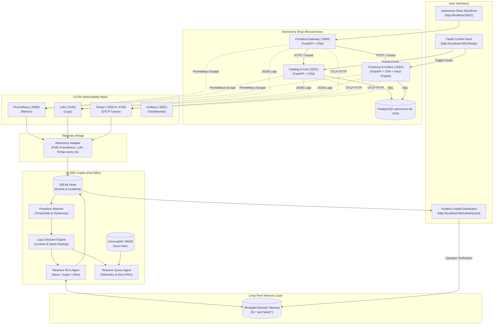

# Autonomous Incident Response Agent with NVIDIA Nemotron & Laya Engine

An autonomous, multi-agent AI Site Reliability Engineering (SRE) copilot built for cloud-native microservices. It continuously monitors live telemetry across a focused microservices mesh and an OpenTelemetry/LGTM observability stack, diagnoses root causes using **NVIDIA Nemotron** models tiered by reasoning complexity, validates hypotheses against runtime context with a fast **Laya System 1** decision engine, and retains verified procedural fixes in **Hindsight** episodic memory.

---

## 1. Key Capabilities

* **Multi-Agent Architecture**:
  * **Proactive Alerting Agent**: Continuous watcher evaluating request volume, 5xx error rates, p95 latencies, and log anomalies with hysteresis to prevent flapping.
  * **Reactive RCA Agent**: Autonomous diagnosis with dynamic Nemotron model tier selection (**Nano**, **Super**, **Ultra**) based on whether an incident has historical precedent or context shifts.
  * **Reactive Query Agent**: Read-only operator assistant answering telemetry, metric, trace, log, and architecture questions with sub-second RAG lookups and zero thought leakage.
* **Laya Decision Engine**:
  * Fast System 1 classification distinguishing identical root causes from context shifts (`same_context` vs `different_context`) and routing operator prompts (`rca` vs `query`).
* **Astronomy Shop Microservices Mesh (3 Services + DB)**:
  * **Frontend Gateway** (`astronomy-frontend` on port 8080): Modern space-themed storefront UI and API gateway.
  * **Catalog & Cart Service** (`astronomy-catalog` on port 5001): Product catalog and cart management backed by PostgreSQL.
  * **Checkout & Order Service** (`astronomy-checkout` on port 5002): Order orchestration, payments, and fault injection engine.
  * **PostgreSQL Database** (`astronomy-db` on port 5432): Product catalog, customer carts, and persistent order store.
* **Interactive Runtime Faults Dashboard (`http://localhost:9922/faults`)**:
  * Live control deck with one-click toggles to inject payment failures, high latency, database pool exhaustion, static image delays, and memory leaks.
* **Full OpenTelemetry & LGTM Observability**:
  * Distributed tracing via Grafana Tempo (`http://localhost:3200`) with W3C `traceparent` propagation across all service hops.
  * Prometheus metrics (`http://localhost:9090`) scraping `/metrics` endpoints for error rates and latency histograms.
  * Structured JSON logging streaming into Grafana Loki (`http://localhost:3100`).
* **Dark-Mode Operations Dashboard & Fix Verification**:
  * Live monitoring console at `http://localhost:9911/dashboard` with one-click **"Fix Worked"** and **"Fix Failed"** verification recording outcomes into Hindsight memory.

---

## 2. Architecture



---

## 3. NVIDIA Nemotron Dynamic Tiers

The Reactive RCA Agent dynamically dispatches to different Nemotron tiers based on precedent and context classification from the Laya engine:

| Tier | Model | Trigger Condition | Reasoning Profile |
|---|---|---|---|
| **Nano** | `nvidia/nemotron-3.5-lightning-30b-a3b` | Repeat incident, **same context** | Fast adjustment & confirmation of known procedural fix |
| **Super** | `nvidia/nemotron-3.5-super-vl-120b-a12b` | Similar incident, **context shift** | Guided diagnosis reasoning over telemetry shifts |
| **Ultra** | `nvidia/nemotron-3.5-super-vl-120b-a12b` | **New / 0-day** incident | Deep multi-step investigation across traces, metrics & logs |

---

## 4. Runtime Faults Dashboard (`/faults`)

The system includes a dedicated runtime fault injection interface at **`http://localhost:9922/faults`**:

| Fault Name | Target Service | Mechanism & Simulated Cause | Detectable In Telemetry |
| :--- | :--- | :--- | :--- |
| **Payment Failure** | `checkout` | Injects 500/502 errors on `POST /checkout` | 5xx error rate spike in Prometheus & Copilot |
| **High Latency Spike** | `catalog` / `checkout` | Adds configurable delay (2.5s - 3.5s) on API calls | p95 latency spike in Prometheus & Tempo traces |
| **DB Pool Exhaustion** | `checkout` | Holds DB connections open indefinitely | Connection timeout exceptions in Loki & 503 errors |
| **Product Image Delay** | `frontend` | Simulates slow static asset loading | Asset latency & span timeline gap |
| **Memory Leak Simulation** | `catalog` | Retains payload buffers on every request | Leaked memory metadata in event context |
| **Service Error Spike (503)** | `catalog` | 80% failure rate with HTTP 503 | Sudden error rate breach |

---

## 5. Setup & Getting Started

### 5.1 Prerequisites
* **Docker Engine** & **Docker Compose v2+**
* **Python 3.10+** (if running the indexing script or test suite locally)
* **NVIDIA NIM API Key** (`NVIDIA_API_KEY`) from [build.nvidia.com](https://build.nvidia.com) (used for Nemotron Nano, Super, and Ultra model tiers)
* **Groq API Key** (`HINDSIGHT_LLM_API_KEY`) for Hindsight episodic memory extraction and fallback reasoning

---

### 5.2 Setup Steps

#### 1. Configure Environment Variables
Copy the template and supply your API credentials:
```bash
cp .env.example .env
```
Open `.env` and fill in your keys:
```dotenv
NVIDIA_API_KEY=nvapi-your-key-here
HINDSIGHT_LLM_API_KEY=gsk_your-groq-key-here
# Optional: Discord notification channel
DISCORD_WEBHOOK_URL=https://discord.com/api/webhooks/...
```

#### 2. Run the Documentation RAG Indexing Script
Before launching the copilot, vectorize the architecture and runbook documentation into ChromaDB and generate the BM25 fallback index. This enables the Reactive Query Agent and RCA Agent to perform sub-second semantic retrieval on operational runbooks:

```bash
chmod +x scripts/index_docs.sh
./scripts/index_docs.sh
```

*Alternatively, execute the Python indexer directly:*
```bash
python3 Copilot/scripts/index_docs.py \
  --docs-path otel_demo/docs \
  --chroma-path Copilot/data/chroma_db \
  --collection astronomy_shop_docs \
  --index-path Copilot/data/docs_index.json
```
This populates:
* `Copilot/data/chroma_db/`: Persistent ChromaDB vector database with cosine embeddings.
* `Copilot/data/docs_index.json`: Pre-computed BM25 inverted index for instant lexical fallback.

#### 3. Build Docker Images
Build the application microservices (`frontend`, `catalog`, `checkout`), the AI SRE Copilot, and the telemetry adapter:
```bash
docker compose build
```
*(Optionally build in parallel with `docker compose build --parallel`)*.

---

### 5.3 Starting the Stack

#### 1. Launch All Services in Detached Mode
```bash
docker compose up -d
```

#### 2. Verify Container Health
```bash
docker compose ps
```
All 10 services should report `running` (or `healthy`). To follow Copilot startup and detection logs:
```bash
docker compose logs -f copilot
```

---

### 5.4 Service Ports & Web Interfaces

Once started, the following services and user interfaces are immediately accessible on `localhost`:

| Service | Container | Host URL / Port | Internal Port | Description |
| :--- | :--- | :--- | :--- | :--- |
| **Astronomy Shop Storefront** | `astronomy-frontend` | [http://localhost:9922](http://localhost:9922) | `8080` | Web store UI and gateway with automated synthetic traffic. |
| **Runtime Faults Control Deck** | `astronomy-frontend` | [http://localhost:9922/faults](http://localhost:9922/faults) | `8080` | Interactive chaos console to inject runtime anomalies. |
| **Copilot Incident Dashboard** | `incident-copilot` | [http://localhost:9911/dashboard](http://localhost:9911/dashboard) | `8001` | Live incident queue, timeline, memory recall, and fix verification. |
| **Copilot Chat Assistant** | `incident-copilot` | [http://localhost:9911](http://localhost:9911) | `8001` | Multi-turn conversational SRE operator assistant. |
| **Grafana Dashboards** | `grafana` | [http://localhost:3001](http://localhost:3001) | `3000` | LGTM dashboards and telemetry correlation (Credentials: `admin` / `admin`). |
| **Prometheus Metrics** | `prometheus` | [http://localhost:9090](http://localhost:9090) | `9090` | Metrics scraper and raw PromQL evaluation UI. |
| **Tempo Distributed Tracing** | `astronomy-tempo` | [http://localhost:3200](http://localhost:3200) | `3200` | Trace search UI and OTLP HTTP receiver (`:4318`). |
| **Loki Log Aggregator** | `astronomy-loki` | [http://localhost:3100](http://localhost:3100) | `3100` | Structured JSON log query endpoint. |
| **Hindsight Memory Engine** | `incident-hindsight` | [http://localhost:9999](http://localhost:9999) | `9999` (UI) / `8888` (API) | Episodic and procedural memory store. |
| **Catalog Microservice** | `astronomy-catalog` | [http://localhost:5001](http://localhost:5001) | `5001` | Product catalog and cart REST API. |
| **Checkout Microservice** | `astronomy-checkout` | [http://localhost:5002](http://localhost:5002) | `5002` | Order processing and fault injection engine. |
| **PostgreSQL Database** | `astronomy-db` | `localhost:5433` | `5432` | Postgres 16 database storing products, carts, and orders. |

---

### 5.5 Running Verification Tests

Execute the automated test suite locally:
```bash
pytest -q
```
All unit, integration, and security tests execute against pre-computed mocks and indices with zero external API dependencies.

---

### 5.6 Teardown

To stop all containers and tear down the network:
```bash
docker compose down
```
To also purge persisted database volumes and copilot stores:
```bash
docker compose down -v
```
