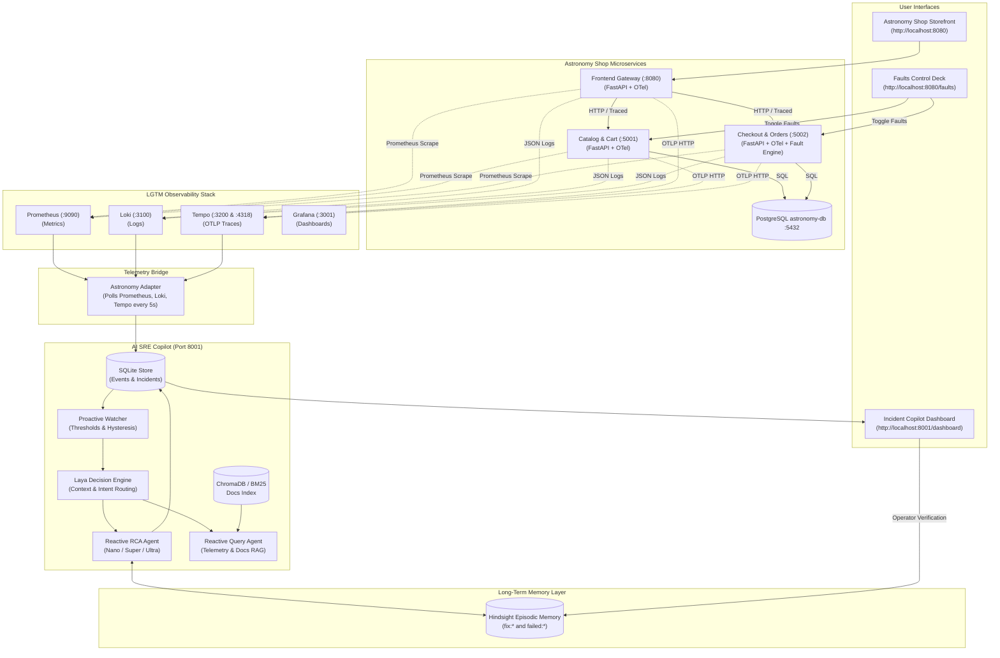

# Autonomous Incident Response Agent with NVIDIA Nemotron & Laya Engine

An autonomous, multi-agent AI Site Reliability Engineering (SRE) copilot built for cloud-native microservices. It continuously monitors live telemetry across a focused microservices mesh and an OpenTelemetry/LGTM observability stack, diagnoses root causes using **NVIDIA Nemotron** models tiered by reasoning complexity, validates hypotheses against runtime context with a fast **Laya System 1** decision engine, and retains verified procedural fixes in **Hindsight** episodic memory.

---

## 1. Key Capabilities

* **Multi-Agent Architecture**:
  * **Proactive Alerting Agent**: Continuous watcher evaluating request volume, 5xx error rates, p95 latencies, and log anomalies with hysteresis to prevent flapping.
  * **Reactive RCA Agent**: Autonomous diagnosis with dynamic Nemotron model tier selection (**Nano**, **Super**, **Ultra**) based on whether an incident has historical precedent or context shifts.
  * **Reactive Query Agent**: Read-only operator assistant answering telemetry, metric, trace, log, and architecture questions with sub-second RAG lookups and zero thought leakage.
* **Laya Decision Engine**:
  * Fast System 1 classification distinguishing identical root causes from context shifts (`same_context` vs `different_context`) and routing operator prompts (`rca` vs `query`).
* **Astronomy Shop Microservices Mesh (3 Services + DB)**:
  * **Frontend Gateway** (`astronomy-frontend` on port 8080): Modern space-themed storefront UI and API gateway.
  * **Catalog & Cart Service** (`astronomy-catalog` on port 5001): Product catalog and cart management backed by PostgreSQL.
  * **Checkout & Order Service** (`astronomy-checkout` on port 5002): Order orchestration, payments, and fault injection engine.
  * **PostgreSQL Database** (`astronomy-db` on port 5432): Product catalog, customer carts, and persistent order store.
* **Interactive Runtime Faults Dashboard (`http://localhost:8080/faults`)**:
  * Live control deck with one-click toggles to inject payment failures, high latency, database pool exhaustion, static image delays, and memory leaks.
* **Full OpenTelemetry & LGTM Observability**:
  * Distributed tracing via Grafana Tempo (`http://localhost:3200`) with W3C `traceparent` propagation across all service hops.
  * Prometheus metrics (`http://localhost:9090`) scraping `/metrics` endpoints for error rates and latency histograms.
  * Structured JSON logging streaming into Grafana Loki (`http://localhost:3100`).
* **Dark-Mode Operations Dashboard & Fix Verification**:
  * Live monitoring console at `http://localhost:8001/dashboard` with one-click **"Fix Worked"** and **"Fix Failed"** verification recording outcomes into Hindsight memory.

---

## 2. Architecture



---

## 3. NVIDIA Nemotron Dynamic Tiers

The Reactive RCA Agent dynamically dispatches to different Nemotron tiers based on precedent and context classification from the Laya engine:

| Tier | Model | Trigger Condition | Reasoning Profile |
|---|---|---|---|
| **Nano** | `nvidia/nemotron-3.5-lightning-30b-a3b` | Repeat incident, **same context** | Fast adjustment & confirmation of known procedural fix |
| **Super** | `nvidia/nemotron-3.5-super-vl-120b-a12b` | Similar incident, **context shift** | Guided diagnosis reasoning over telemetry shifts |
| **Ultra** | `nvidia/nemotron-3.5-super-vl-120b-a12b` | **New / 0-day** incident | Deep multi-step investigation across traces, metrics & logs |

---

## 4. Runtime Faults Dashboard (`/faults`)

The system includes a dedicated runtime fault injection interface at **`http://localhost:8080/faults`**:

| Fault Name | Target Service | Mechanism & Simulated Cause | Detectable In Telemetry |
| :--- | :--- | :--- | :--- |
| **Payment Failure** | `checkout` | Injects 500/502 errors on `POST /checkout` | 5xx error rate spike in Prometheus & Copilot |
| **High Latency Spike** | `catalog` / `checkout` | Adds configurable delay (2.5s - 3.5s) on API calls | p95 latency spike in Prometheus & Tempo traces |
| **DB Pool Exhaustion** | `checkout` | Holds DB connections open indefinitely | Connection timeout exceptions in Loki & 503 errors |
| **Product Image Delay** | `frontend` | Simulates slow static asset loading | Asset latency & span timeline gap |
| **Memory Leak Simulation** | `catalog` | Retains payload buffers on every request | Leaked memory metadata in event context |
| **Service Error Spike (503)** | `catalog` | 80% failure rate with HTTP 503 | Sudden error rate breach |

---

## 5. Quickstart

### Prerequisites
* Docker Desktop & Docker Compose
* NVIDIA NIM API key (`NVIDIA_API_KEY`) from [build.nvidia.com](https://build.nvidia.com)
* Groq API key for Hindsight memory extraction (`HINDSIGHT_LLM_API_KEY`)

### Setup & Startup

1. **Configure environment**:
   ```bash
   cp .env.example .env
   # Add your NVIDIA_API_KEY and HINDSIGHT_LLM_API_KEY to .env
   ```

2. **Launch the entire stack**:
   ```bash
   docker compose up -d --build
   ```

3. **Access Services**:
   * **Astronomy Shop Store**: [http://localhost:8080](http://localhost:8080)
   * **Faults Control Deck**: [http://localhost:8080/faults](http://localhost:8080/faults)
   * **Incident Copilot Dashboard**: [http://localhost:8001/dashboard](http://localhost:8001/dashboard)
   * **Grafana**: [http://localhost:3001](http://localhost:3001) (admin / admin)
   * **Prometheus**: [http://localhost:9090](http://localhost:9090)
   * **Tempo Traces**: [http://localhost:3200](http://localhost:3200)
   * **Hindsight Console**: [http://localhost:9999](http://localhost:9999)

### Running Tests

```bash
pytest -q
```
All 325 unit and integration tests execute and pass in under 2 seconds.
